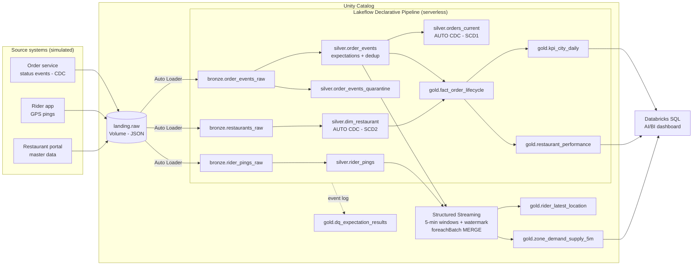

# Food Delivery Operations Lakehouse on Databricks

An end-to-end, streaming-first lakehouse for a quick-commerce **food delivery platform** (think Swiggy / Zomato / Uber Eats), built on **Databricks** with **PySpark**, **Auto Loader**, **Lakeflow Declarative Pipelines**, **Structured Streaming**, **Delta Lake**, **Unity Catalog** and **Lakeflow Jobs**, deployed as code with **Databricks Asset Bundles** and tested in **GitHub Actions**.

It answers the questions an operations team at a delivery company asks every day:

* Are we keeping the delivery promise? (delivery time, p90, **SLA breach %** per city)
* Where is the time lost: restaurant acceptance, **kitchen prep**, or **last mile**?
* Why are orders cancelled, and does a **rider shortage** cause them?
* Which **zones need surge pricing or more riders right now**? (5-minute demand vs. supply)
* How much commission did we earn, using the commission **valid at the time of each order** (SCD Type 2)?

---

## Architecture



Orchestration (Lakeflow Jobs, defined in `resources/food_delivery.job.yml`):

```
setup_unity_catalog -> generate_source_events -> medallion_pipeline -+-> zone_demand_streaming
                                                                     +-> data_quality_report
```

## What makes the data realistic

`src/fooddelivery/simulator.py` plays the role of the upstream systems. It is deterministic (seeded), resumable between job runs, and intentionally messy:

| Real-world problem | How it shows up | How the platform handles it |
|---|---|---|
| Client retries | ~3% duplicate events with the same `event_id` | `dropDuplicatesWithinWatermark` in Silver |
| Late-arriving data | ~2% of events land in a later file than their event time | 30-min event-time watermark; AUTO CDC `sequence_by` never moves an order backwards |
| Out-of-order status changes | events with equal timestamps | `sequence_by = struct(event_ts, status_rank)` tie-breaker |
| Bad records | null `order_id`/`restaurant_id`, negative amounts, unknown statuses, 0,0 GPS | `expect_all_or_drop` + quarantine table with the failed rule names |
| Schema drift | app v5.2 starts sending `tip_amount` from batch 4 | Auto Loader `addNewColumns`; `tip_amount` defaulted for old rows |
| Slowly changing master data | restaurant commission / active flag / cuisine change over time | AUTO CDC **SCD Type 2** + point-in-time join in Gold |
| Peak hours and rider shortage | lunch/dinner peaks in IST, finite riders per zone | `NO_RIDER_AVAILABLE` cancellations; surge flag per zone |

A 12-hour simulated day produces roughly 27K order events, 180K rider pings, ~6.8K orders across Hyderabad, Bengaluru, Chennai and Mumbai, with ~8–9% cancellations and ~11% SLA breaches.

## Repository layout

```
databricks.yml                     Asset Bundle (dev / prod targets, catalog variable)
resources/
  food_delivery.pipeline.yml       Lakeflow Declarative Pipeline definition (serverless)
  food_delivery.job.yml            Lakeflow Job: 5 tasks, schedule, retries, parameters
pipelines/
  bronze.py                        Auto Loader streaming tables + ingestion metadata
  silver.py                        typing, dedup, expectations, quarantine, AUTO CDC SCD1/SCD2
  gold.py                          materialized views: lifecycle fact, city KPIs, restaurant scorecard
notebooks/
  00_setup_unity_catalog.sql       schemas, landing Volume, grants
  01_generate_events.py            runs the simulator, writes JSON to the Volume
  02_zone_demand_streaming.py      Structured Streaming windows + foreachBatch MERGE
  03_data_quality_report.py        expectation metrics from the pipeline event log
src/fooddelivery/
  transforms.py                    all PySpark business logic (pure functions, unit tested)
  quality.py                       data quality rules shared by expectations and quarantine
  simulator.py                     source data simulator
  config.py                        SLA, watermark, window size, statuses, cities
sql/dashboard_queries.sql          queries for the Databricks SQL / AI/BI dashboard
tests/                             pytest suite run locally and in CI (incl. a real streaming test)
.github/workflows/ci.yml           lint + tests on every PR, bundle deploy on main
```

## Run it (Databricks Free Edition works)

1. Create a free workspace at Databricks Free Edition. Generate a personal access token (User settings -> Developer).
2. Install the Databricks CLI and authenticate:
   ```bash
   databricks configure        # host = your workspace URL, token = the PAT
   ```
3. Deploy and run:
   ```bash
   databricks bundle validate
   databricks bundle deploy -t dev
   databricks bundle run -t dev food_delivery_job
   ```
   Each run adds one simulated hour of business. Run it 3–4 times to see dinner-peak surge windows.
4. Explore the tables in Catalog Explorer, open the pipeline graph, and paste `sql/dashboard_queries.sql` into a Databricks SQL dashboard.

The catalog defaults to `workspace` (exists in Free Edition). Use another one with `--var catalog=<name>`.

### Run the tests locally

```bash
python -m venv .venv && source .venv/bin/activate
pip install -r requirements-dev.txt      # needs Java 17
pytest -q
```

## Key design decisions

* **Business logic lives in `src/`, not in pipeline files.** The pipeline files only declare tables; every transformation is a pure DataFrame function, so it is unit-tested locally and in CI without a cluster.
* **Bronze is append-only and keeps everything** (with `_source_file`, `_ingested_at`), so Silver/Gold can always be rebuilt with a full refresh.
* **Bad data is quarantined, not just dropped.** The same rule dictionary drives the expectations and the quarantine table, so both sides always agree; the event log turns expectation results into a trended Gold table.
* **AUTO CDC instead of hand-written MERGE** for order state and restaurant history: it handles out-of-order events and SCD2 bookkeeping (`__START_AT`/`__END_AT`) declaratively.
* **One windowed aggregation instead of a stream-stream join** for demand vs. supply: both streams are unioned into a common shape, which keeps state small and simple.
* **`foreachBatch` + MERGE** makes the streaming outputs idempotent and lets late data update an existing window row.
* **`availableNow` trigger and serverless compute** give exactly-once streaming semantics at batch cost; switching to continuous is a config change.
* **Liquid clustering** (`cluster_by`) on the large tables instead of static partitioning.
* **Everything is code**: pipeline, job, schedule and parameters are deployed by Asset Bundles from GitHub Actions.

## Possible extensions

* Replace the Volume landing zone with Kafka / Event Hubs as the order-event source.
* Add a delivery-time prediction model (features from `fact_order_lifecycle`, MLflow, Model Serving).
* Column masks on `customer_id` and row filters per city for regional ops teams.
* SQL alerts on `sla_breach_pct` and `pass_rate_pct`.
